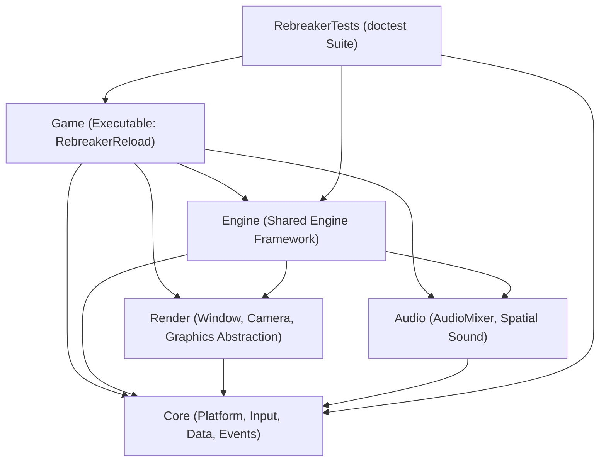
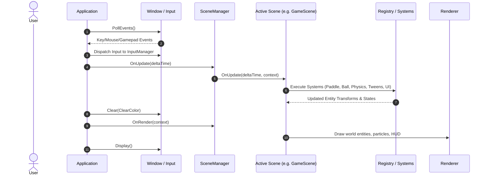
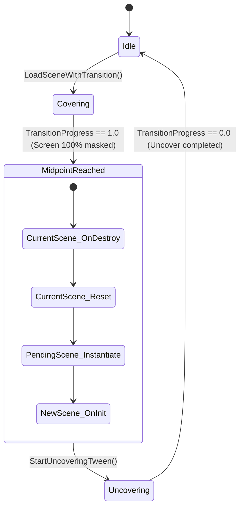
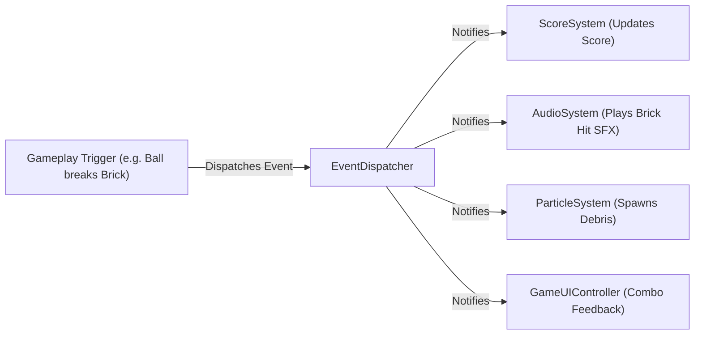

# REBREAKER-Reloaded Architecture Overview

## 1. System Overview & Design Philosophy

**REBREAKER-Reloaded** is a modern arcade brick-breaker built in C++20 using an event-driven, cache-friendly Entity-Component-System (ECS) architecture powered by SFML 3 for rendering, windowing, and audio primitives.

The project is structured around three foundational architectural principles:

1. **Strict Engine-Game Decoupling**: The engine layer (`Engine`, `Core`, `Render`, `Audio`) provides reusable, game-agnostic systems (event buses, scene graphs, component storage, resource management, mathematical utilities, rendering abstractions). The game layer (`Game`) contains gameplay rules, brick types, power-ups, UI controllers, and stage scenes.
2. **Data-Oriented & Cache-Friendly ECS**: Entities are lightweight integer handles (`Entity` / `uint32_t`). Components are plain data structs (POD-like). Logic is partitioned into modular systems (`UISystem`, `BallSystem`, `PaddleSystem`, `CollisionSystem`) operating over component views.
3. **Reactive Event-Driven Communication**: Subsystems communicate asynchronously and loosely via a centralized type-safe `EventDispatcher` utilizing `ScopedSubscription` RAII tokens to prevent dangling listeners and memory leaks across scene reloads.

---

## 2. Layered Module Architecture

The project is structured into 5 CMake targets:



### Module Responsibilities

| Target / Module | Directory | Description & Responsibilities |
|---|---|---|
| **Core** | `Core/` | Foundational primitives: `EventDispatcher`, `InputManager`, `InputRemapManager`, `PlayerPrefs`, `GameRules`, `Timer`, math vectors (`Vector2f`), color structures, and utility routines. |
| **Render** | `Render/` | Graphics subsystem wrapping SFML 3: `Window`, `Camera2D`, `Renderer`, batching helpers, and logical resolution viewports. |
| **Audio** | `Audio/` | Multi-channel sound mixer: `AudioMixer`, volume attenuation, pitch modulation, panning, spatial falloff, and audio device enumeration. |
| **Engine** | `Engine/` | ECS registry (`Registry`, `Entity`), component containers, generic scene manager (`SceneManager`, `Scene`), resource cache (`ResourceManager`), tweening engine (`TweenComponent`), and UI framework (`UISystem`, `UIFactory`). |
| **Game** | `Game/` | Complete game implementation: scenes (`MenuScene`, `GameScene`, `CustomGameScene`, `EndlessScene`, `LevelSelectScene`, `SandboxScene`), brick entities, 16 power-ups, ultimate abilities, `SettingsUIController`, and leaderboards. |
| **Tests** | `Tests/` | 153+ automated unit and integration tests executing under `doctest`. |

---

## 3. Core Engine Lifecycle & Execution Flow

The runtime loop is managed by `Application` (`Game/source/Application.cpp`). Each frame executes through clearly demarcated phases:



### Frame Loop Invariants:
1. **Delta Time Clamping**: Frame delta time is clamped to avoid simulation explosion when the window is dragged or suspended.
2. **Event Dispatch Prioritization**: Window events and input mapping are updated strictly before scene updates.
3. **Render Decoupling**: Gameplay simulation operates in world coordinates; rendering projects through `Camera2D` or virtual screen metrics (such as the Retro CRT 1920x1080 canvas).

### 3.1 Scene Lifecycle & Two-Phase Transitions (`SceneManager`)

Scene transitions (e.g. `SceneTransitionType::StaticSnow`, `SceneTransitionType::FadeBlack`) are managed through a two-phase tweening lifecycle:



- **Deterministic Teardown Rule**: During `OnDestroy()`, scenes must never manually deallocate (`reset()`) resources shared with the active renderer (such as active `sf::RenderTexture` FBOs or background music streams). All class member deallocations are safely deferred to standard C++ destructor execution (`~Scene()`) after `OnDestroy()` returns.
- **Embedded Mode Isolation**: Sub-scenes embedded inside UI widgets (such as Workshop `PreviewScene`s) are flagged with `m_isEmbeddedMode = true`. When destroyed, embedded scenes clear only their local ECS entities and scoped subscriptions without touching global music playlists or re-triggering file persistence.
- **Automated Verification Harness (`--smoke-test`)**: The engine integrates an automated smoke-test command (`RebreakerReload.exe --smoke-test`) that programmatically validates the full cycle `MenuScene` $\rightarrow$ `GameScene` $\rightarrow$ `EndlessScene` $\rightarrow$ `MenuScene` under real SFML window and OpenGL render conditions without manual user input.

---

## 4. Entity-Component-System (ECS) Architecture

The ECS framework is located in `Engine/include/ECS/`.

### Key Abstractions

- **`Entity` (`ECS/Entity.h`)**: A lightweight 32-bit identifier with generation versioning to detect stale entity references.
  ```cpp
  using Entity = uint32_t;
  constexpr Entity NULL_ENTITY = 0xFFFFFFFF;
  ```
- **`Registry` (`ECS/Registry.hpp`)**: The central database storing component sparse arrays. It provides:
  - `CreateEntity()` / `DestroyEntity(Entity)`
  - `AddComponent<T>(Entity, Args...)`
  - `GetComponent<T>(Entity)`
  - `HasComponent<T>(Entity)`
  - `RemoveComponent<T>(Entity)`
  - `View<T1, T2...>(Callable)`: Iterates entities possessing all specified component types in continuous memory buffers.
  - `ForEach<T>(Callable)`: Single component fast scan.

### Component Taxonomy

```mermaid
classDiagram
    class Transform2D {
        +Vector2f Position
        +Vector2f Scale
        +float Rotation
    }
    class VelocityComponent {
        +Vector2f Velocity
        +float MaxSpeed
    }
    class ColliderComponent {
        +ColliderType Type
        +Vector2f Size
        +float Radius
        +bool IsTrigger
    }
    class BrickComponent {
        +BrickType Type
        +int MaxHits
        +int CurrentHits
        +uint32_t ScoreValue
        +bool IsIndestructible
    }
    class BallComponent {
        +float Speed
        +bool IsAttachedToPaddle
        +bool IsFireBall
        +bool IsPlasmaBall
    }
    class PaddleComponent {
        +float Speed
        +float Width
        +bool HasLaser
        +bool HasSticky
    }
    class CanvasComponent {
        +bool IsEnabled
        +int ZOrder
    }
    class RectTransform {
        +Vector2f Position
        +Vector2f Size
        +Anchor AnchorPoint
        +Entity Parent
    }
    class ButtonComponent {
        +ButtonState State
        +function OnClick
        +Color DefaultColor
        +Color HoverColor
    }
```



---

## 5. Event-Driven Communication (`EventDispatcher`)

Subsystems avoid hard mutual coupling by publishing and subscribing to strongly-typed event structs located in `Core/include/Events/` and `Game/include/Events/`.

### Architecture



### RAII Scoped Subscriptions (`ScopedSubscription`)

To prevent memory corruption and stale callbacks when scenes transition, listeners use `ScopedSubscription`:

```cpp
// Inside GameUIController::SetupSubscriptions()
m_scoreSub = m_context.Events.SubscribeScoped<ScoreUpdatedEvent>(
    [this](const ScoreUpdatedEvent& e) {
        UpdateScoreHUD(e.CurrentScore);
    }
);
// When GameUIController is destroyed, m_scoreSub automatically unsubscribes!
```

---

## 6. Service Locator: `GameContext`

The `GameContext` structure (`Engine/include/Core/GameContext.h`) acts as a non-owning unified service locator passed to scene methods and systems:

```cpp
struct GameContext {
    Renderer&        Render;
    AudioMixer&      Audio;
    ResourceManager& Resources;
    SceneManager&    Scenes;
    InputManager&    Input;
    EventDispatcher& Events;
    GameRules&       Rules;
};
```

This guarantees consistent access to core services without relying on error-prone static singletons, simplifying mocking and automated testing.

