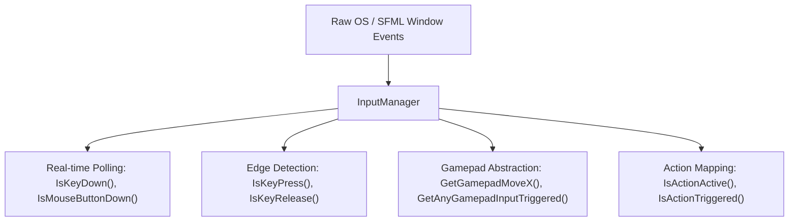
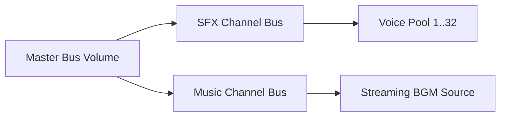
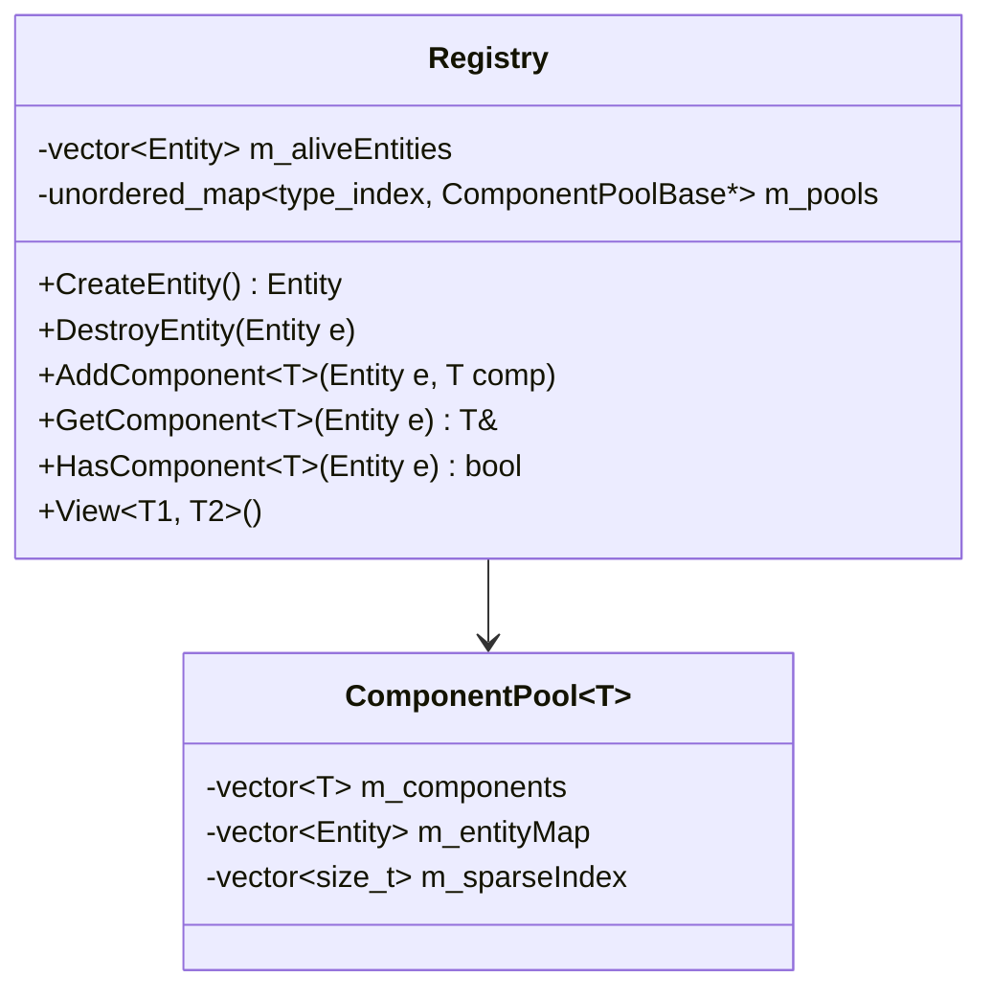

# Engine Subsystems Technical Manual

This document details the low-level engine architecture and subsystems underpinning **REBREAKER-Reloaded**, located across the `Core/`, `Render/`, `Audio/`, and `Engine/` directories.

---

## 1. Core Subsystem (`Core/`)

The `Core` module provides platform utilities, input mappings, event dispatching, persistent configuration, and mathematical foundations.

### 1.1 InputManager & Unified Input Handling (`Core/include/Core/InputManager.h`)

The `InputManager` unifies keyboard, mouse, and multi-gamepad controllers into an event-polled abstraction.



#### Key Capabilities
- **Frame-Accurate Edge Detection**: Tracks both the current and previous frame states (`m_keysCurrent`, `m_keysPrevious`) to accurately identify key presses (`IsKeyPress`), releases (`IsKeyRelease`), and holding states (`IsKeyDown`).
- **Deadzone & Stick Filtering**: Dual analog thumbstick filtering with customizable radial deadzones for jitter-free paddle movement (`GetGamepadMoveX`, `GetGamepadMoveY`).
- **Gamepad Button & Trigger Detection**: Supports direct index triggers and directional triggers (D-Pad or Stick) with `GetAnyGamepadInputTriggered(unsigned int joyId)` for rebinding sessions.
- **Menu Navigation Abstraction**: Pre-baked directional queries (`IsMenuUpTriggered`, `IsMenuDownTriggered`, `IsMenuSelectTriggered`, `IsMenuCancelTriggered`) that combine D-pad, analog stick, and arrow/WASD/Escape keys.

### 1.2 InputRemapManager (`Core/include/Core/InputRemapManager.h`)

Encapsulates player-customizable key rebinding:
- Supports 4 primary game actions: `InputAction::MoveLeft`, `InputAction::MoveRight`, `InputAction::LaunchBall`, `InputAction::Pause`.
- Independent bindings for **Keyboard** (`KeyCode`) and **Gamepad** (`int` joy button / axis).
- Persistence backed by `PlayerPrefs`: saves to disk and restores on launch.
- Automatic fallback defaults (`A`/`D`/`Left`/`Right`, `Space`, `Escape`).

### 1.3 EventDispatcher & Type-Safe Events (`Core/include/Events/EventDispatcher.h`)

The `EventDispatcher` implements an in-memory publish-subscribe pattern with type erasure based on C++ `std::type_index`:

```cpp
template<typename TEvent>
SubscriptionId Subscribe(std::function<void(const TEvent&)> callback);

template<typename TEvent>
ScopedSubscription SubscribeScoped(std::function<void(const TEvent&)> callback);

template<typename TEvent>
void Dispatch(const TEvent& event);
```

- **Thread-Safety Invariant**: Dispatches synchronously on the main thread, avoiding race conditions in ECS systems.
- **`ScopedSubscription` RAII Guard**: Unsubscribes on destructor call, ensuring zero dangling callbacks when controllers or scenes unload.

### 1.4 PlayerPrefs & GameRules (`Core/include/Core/PlayerPrefs.h`, `GameRules.h`)

- **`PlayerPrefs`**: Key-value persistent store saving to JSON (`SaveData/prefs.json`). Handles audio volume sliders, graphics toggles (fullscreen, shaders, particles), resolution indices, and input rebinds.
- **`GameRules`**: Dynamic runtime rule registry (`Rule::Gameplay::*`, `Rule::Cheats::*`). Allows modifiers (e.g. `GodMode`, `InstantBreak`, `CheatsUnlocked`) to be queried and mutated on the fly without hardcoded conditionals.

---

## 2. Rendering Subsystem (`Render/`)

The `Render` module wraps SFML 3 graphics rendering and provides logical viewport mapping, 2D camera control, and batching.

### 2.1 Window Management (`Render/include/System/Window.h`)

- Wraps `sf::RenderWindow` with customized configuration (`WindowConfig`).
- Handles **Fullscreen / Windowed toggles** seamlessly with resolution recreation.
- Implements VSync and custom frame rate limit caps.

### 2.2 Logical Viewport & Aspect Ratio Scaling (`Render/include/Graphics/Renderer.h`)

To ensure identical gameplay physics and UI layouts across any monitor resolution (16:9, 16:10, 21:9), the `Renderer` operates on a fixed **Logical Viewport** (e.g. $1920 \times 1080$):

$$\text{Scale} = \min\left(\frac{W_{\text{window}}}{W_{\text{logical}}}, \frac{H_{\text{window}}}{H_{\text{logical}}}\right)$$

- Pillarboxing / Letterboxing are applied automatically with black borders.
- Coordinates between mouse cursor screen positions and logical world positions are translated via `ScreenToWorld(Vector2f)`.

### 2.3 Camera2D (`Render/include/Graphics/Camera2D.h`)

- Supports 2D position translation, zoom factor, and rotational tilt.
- Used for gameplay screen shake effects, cinematic zooms, and arena transitions.

### 2.4 Primitive & Sprite Rendering API

The `Renderer` provides simplified zero-allocation drawing routines:
- `DrawRectangle(float width, float height, const Transform2D& transform, const Color& color)`
- `DrawRectangleOutline(...)`
- `DrawCircle(float radius, const Transform2D& transform, const Color& color)`
- `DrawLine(const Vector2f& start, const Vector2f& end, const Color& color, float thickness)`
- `DrawSprite(uint32_t textureId, const Transform2D& transform, const Color& tint)`
- `DrawText(const std::string& text, uint32_t fontId, float fontSize, const Transform2D& transform, const Color& color)`

---

## 3. Audio Subsystem (`Audio/`)

Located in `Audio/include/AudioMixer.h`, the audio engine is optimized for high-volume arcade soundscapes.



### 3.1 Multi-Voice SFX Pooling
- Maintains a pool of pre-allocated SFX voices (up to 32 simultaneous sound instances).
- Voice stealing policy: when all channels are active, the voice with lowest remaining duration is recycled.
- Parameters per voice: `Volume` (0..100%), `Pitch` (0.5..2.0x for retro pitch bends), `Pan` (-1.0 left to +1.0 right).

### 3.2 Music Streaming & Transitions
- Continuous background music streaming via SFML sound stream.
- Supports smooth volume fading: `FadeToMusic(path, fadeDuration, targetVolume, loop)`.

### 3.3 Audio Device Enumeration
- Queries OS hardware via SFML audio API: `GetAvailableAudioDevices()`.
- Hot-swaps output device at runtime: `SetAudioDevice(deviceName)`.

---

## 4. Entity-Component-System (ECS) Subsystem (`Engine/`)

The ECS engine (`Engine/include/ECS/`) is a custom data-oriented architecture designed specifically for 60-144 FPS arcade games.

### 4.1 Memory Layout & Component Storage

Components are stored in contiguous memory arrays keyed by entity index:



### 4.2 Query Views (`Registry::View`)

Allows zero-allocation linear iteration over matching entities:

```cpp
m_registry.View<Transform2D, VelocityComponent>([dt](Entity e, Transform2D& t, VelocityComponent& v) {
    t.Position += v.Velocity * dt;
});
```

Because matching components are laid out in linear cache blocks, CPU cache misses are minimized during heavy physics and particle sweeps.

---

## 5. Tweening & Interpolation (`Engine/include/ECS/Tween.h`, `Math/EasingFunctions.h`)

The engine includes a full mathematical tweening pipeline:

### 5.1 Easing Curves
Supported easing algorithms in `EasingFunctions::Ease`:
- `Linear`
- `EaseInQuad`, `EaseOutQuad`, `EaseInOutQuad`
- `EaseInCubic`, `EaseOutCubic`, `EaseInOutCubic`
- `EaseInBounce`, `EaseOutBounce`
- `EaseInElastic`, `EaseOutElastic`

### 5.2 `TweenComponent`
Attached to UI elements, particles, or game entities to smoothly animate values (`float`, `Vector2f`, `Color`) across time durations:

```cpp
m_registry.AddComponent<TweenComponent>(entity, TweenComponent{
    .Start = Vector2f{0.0f, -100.0f},
    .End = Vector2f{0.0f, 0.0f},
    .Duration = 0.35f,
    .Setter = [this, entity](Vector2f pos) {
        if (m_registry.HasComponent<RectTransform>(entity)) {
            m_registry.GetComponent<RectTransform>(entity).Position = pos;
        }
    },
    .Ease = EasingFunctions::EasingType::EaseOutBounce
});
```

