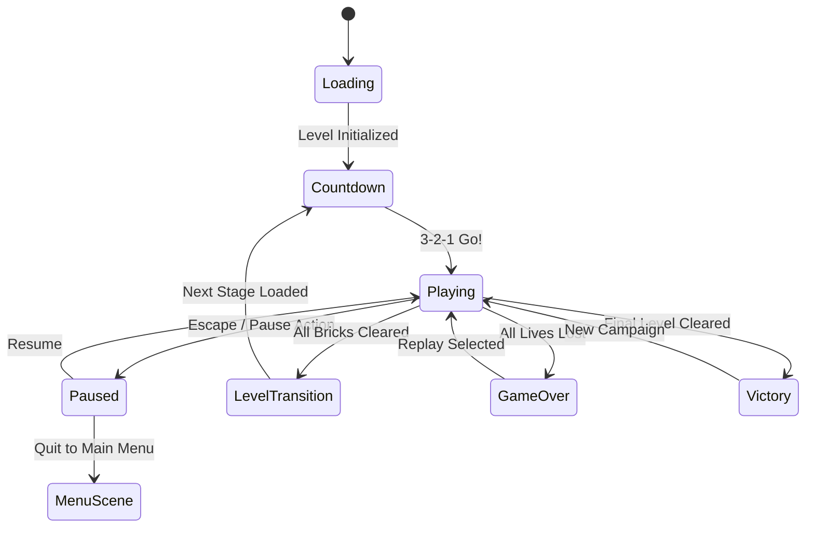
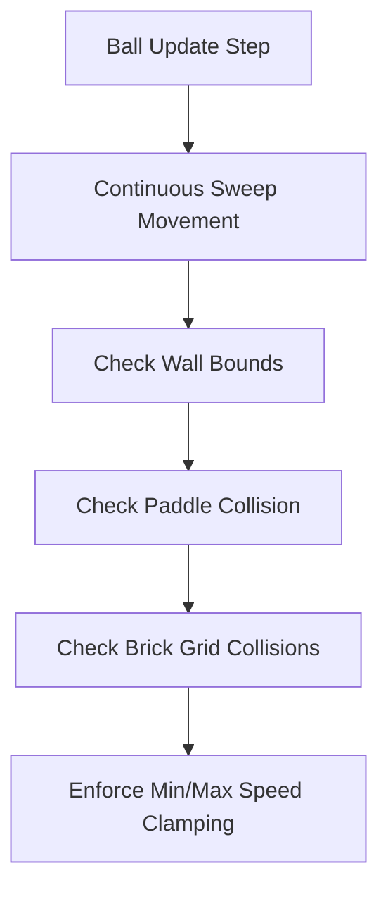
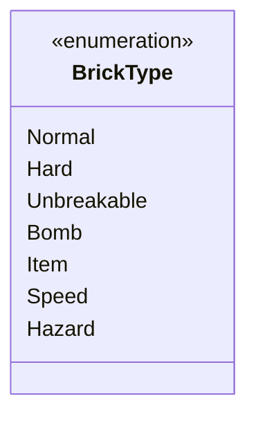
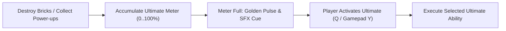

# Gameplay Systems & Mechanics Manual

This document provides an exhaustive breakdown of gameplay simulation, physics models, entity interactions, power-ups, and progression systems in **REBREAKER-Reloaded** (`Game/`).

---

## 1. Game Loop & Finite State Machine (FSM)

Gameplay in `GameScene` is governed by a strict hierarchical State Machine (`StateMachine<GameState>`):

### State Definitions

| State | Gameplay Simulation | Input Handling | UI Displayed |
|---|---|---|---|
| **`Countdown`** | Balls anchored to paddle; timers frozen | Paddle horizontal movement only | 3-2-1 Countdown numbers |
| **`Playing`** | Full physics, collisions, timers, particles active | Complete keyboard & gamepad controls | Standard gameplay HUD |
| **`Paused`** | Physics & timers halted; audio volume reduced | UI modal navigation only | Pause menu or Settings modal |
| **`LevelTransition`** | Remaining balls despawned, stats tallied | Disabled | Level clear summary screen |
| **`GameOver`** | Arena darkens, explosion particles complete | Name entry & modal buttons | Game Over card & Leaderboards |
| **`Victory`** | Confetti and fireworks particle emitters active | Name entry & modal buttons | Victory trophy screen |

---

## 2. Ball Physics & Collision Detection

Ball dynamics are handled in `BallSystem.cpp` and `GameScene.cpp`.

### 2.1 Velocity Clamping & Speed Control
To prevent balls from becoming uncontrollably fast or stalling into flat horizontal trajectories:
- **Minimum Speed**: Enforces $v \ge v_{\min}$ to ensure dynamic pacing.
- **Maximum Speed**: Caps $v \le v_{\max}$ to avoid tunneling through thin colliders.
- **Angle Anti-Stall**: If the vertical angle $|\sin(\theta)| < 0.15$ (ball moving almost purely horizontally), a subtle vertical deflection impulse is injected.

### 2.2 Paddle Reflection & Deflection Model

The reflection vector off the paddle is not purely specular; it is dynamically modulated by the hit point relative to the paddle center:

$$\text{HitFactor} = \frac{X_{\text{ball}} - X_{\text{paddle}}}{\frac{1}{2} W_{\text{paddle}}} \quad \in [-1.0, 1.0]$$

$$\theta_{\text{deflect}} = \text{HitFactor} \times \theta_{\max} \quad (\theta_{\max} \approx 65^\circ)$$

$$\vec{v}_{\text{new}} = \|\vec{v}\| \begin{pmatrix} \sin(\theta_{\text{deflect}}) \\ -\cos(\theta_{\text{deflect}}) \end{pmatrix}$$

- **Edge Hits**: Hitting the extreme edges of the paddle yields sharp angles ($60^\circ$--$65^\circ$), rewarding precise player positioning for targeting high-value bricks.
- **Paddle Motion Bias**: If the paddle is moving rapidly when colliding with the ball, a tangential velocity bias is imparted to the ball's horizontal velocity component.

---

## 3. Paddle Controller & Attachments

Located in `PaddleSystem.cpp`:
- **Speed & Acceleration**: Supports digital instantaneous movement and smooth analog velocity damping.
- **Dynamic Width Scaling**: Default width ($120\text{px}$) can expand up to $220\text{px}$ (`PaddleExpand`) or contract down to $80\text{px}$ under malus conditions.
- **Laser Blasters**: When the `Laser` power-up is active, dual laser emitters spawn at the paddle tips, firing twin projectiles upon player action (`InputAction::LaunchBall`).
- **Sticky Surface**: When active, balls that strike the paddle attach to it rather than bouncing, allowing players to aim and re-launch at will.

---

## 4. Brick Grid Architecture & Brick Archetypes

The brick grid is parsed from level JSON definitions via `LevelManager.cpp`.

### 4.1 Brick Specifications

| Brick Type | Durability (Hits) | Color Tint | Special Behavior |
|---|---|---|---|
| **Normal** | 1 | Stage Palette | Destroys on single hit; awards base score. |
| **Hard** | 2 -- 5 | Silver / Reinforced | Displays visual crack overlays (`brick_crack.png`) at each damage tier. |
| **Unbreakable** | $\infty$ | Gold Metallic | Cannot be destroyed by normal balls; reflects with a sharp metallic clink. Can only be pierced by `FireBall` or ultimates. |
| **Bomb** | 1 | Pulsing Red / TNT | On destruction, detonates a radial explosive shockwave ($R = 120\text{px}$), destroying all neighboring bricks in an explosive cascade. |
| **Item** | 1 | Iridescent Purple | Guaranteed power-up capsule drop on hit. |
| **Speed** | 1 | Cyan / Lightning | Increases ball speed by +15% upon destruction. |
| **Hazard** | 1 | Poison Green / Acid | Emits a temporary hazard field that decreases paddle width or triggers camera shake if struck. |

---

## 5. Combo Multiplier & Score System

Scoring rewards continuous uninterrupted brick destruction without losing the ball.

### Multiplier Formula

$$\text{PointsAwarded} = \text{BaseScore} \times \text{ComboMultiplier}$$

- Each brick destroyed increments `ComboMultiplier` by $+1$.
- Multiplier timer resets after $2.5\text{s}$ without destroying a brick.
- When the multiplier reaches $\ge 5\times$, combo text feedback floats upward (`UI/TextFeedback.cpp`) and the arena background tint shifts toward energetic neon tones.
- Losing a ball drops the multiplier immediately back to $1\times$.

---

## 6. Power-Up Ecosystem (16 Power-Up Types)

Power-ups spawn as falling capsule entities affected by constant gravity. Catching a capsule with the paddle activates its effect.

```mermaid
graph TD
    Ball[Ball Enhancements] --> MB[MultiBall]
    Ball --> FB[FireBall]
    Ball --> PB[PlasmaBall]
    Ball --> SB[SlowBall]
    Ball --> FBt[FastBall]

    Paddle[Paddle Enhancements] --> PE[PaddleExpand]
    Paddle --> PC[PaddleContract]
    Paddle --> LS[Laser]
    Paddle --> ST[Sticky]
    Paddle --> SH[Shield / Bottom Floor]

    Tactical[Tactical Modifiers] --> STM[Storm / Lightning Strike]
    Tactical --> EL[Extra Life]
    Tactical --> SC[Score Bonus]
    Tactical --> MG[Magnet]
    Tactical --> GS[Ghost Ball]
    Tactical --> IN[Inverse Controls]
```

### Power-Up Matrix

| Power-Up | Duration | Effect Description |
|---|---|---|
| **`MultiBall`** | Instant | Splits all active balls into 3 separate balls with divergent trajectories. |
| **`FireBall`** | 12s | Ball turns into a flaming comet; pierces through all bricks without bouncing. |
| **`Laser`** | 15s | Equips paddle with laser cannons. Pressing launch fires damaging beam bolts. |
| **`PaddleExpand`**| 18s | Increases paddle width by +40%. |
| **`PaddleContract`**| 12s | Malus: shrinks paddle width by -30%. |
| **`Sticky`** | 15s | Catches incoming balls; press launch to fire. |
| **`Shield`** | 20s / 1 hit | Creates a protective laser grid at the screen bottom, saving lost balls. |
| **`SlowBall`** | 14s | Decreases all ball velocities by 35% for easier tracking. |
| **`FastBall`** | 10s | Increases ball velocity by 30% with higher score multiplier. |
| **`Storm`** | Instant | Calls down 3 random lightning strikes that obliterate vertical brick columns. |
| **`ExtraLife`** | Instant | Restores one heart container up to the maximum life cap. |
| **`ScoreBonus`** | Instant | Awards +5,000 instant bonus points. |
| **`Magnet`** | 16s | Subtle magnetic pull draws power-up capsules toward the paddle center. |
| **`GhostBall`** | 10s | Ball passes through unbreakable bricks and transparently glides through shields. |
| **`PlasmaBall`** | 12s | High-energy orb triggering mini electric arcs to adjacent bricks on contact. |
| **`InverseControls`**| 8s | Malus: swaps horizontal movement directions (Left $\leftrightarrow$ Right). |

---

## 7. Ultimate Abilities (Super Weapons)

Ultimate abilities provide devastating board-clearing effects charged through active play.

### 7.1 Ultimate Charge Accumulation
- Breaking normal brick: $+2.5\%$ charge.
- Breaking hard / bomb brick: $+5.0\%$ charge.
- Catching power-up capsule: $+8.0\%$ charge.
- Hitting $100\%$ illuminates the HUD meter with a golden glow and triggers `m_ultimateReadySfxId`.

### 7.2 The 3 Ultimate Abilities

#### 1. Plasma Orb (`ExecutePlasmaOrb`)
- Spawns a massive pulsing plasma sphere at the center of the arena.
- Radiates radial electrical arcs every $0.2\text{s}$ that destroy all bricks in expanding concentric rings.
- Level upgrades increase orb lifetime and arc strike count.

#### 2. Disco Ball (`ExecuteDiscoBall`)
- Suspends a glittering mirrored disco ball from the arena ceiling with retro funk music.
- Projects dynamic neon laser beams rotating $360^\circ$, vaporizing any brick intersected.
- Emits floating musical notes across the screen.

#### 3. Lucky Rain (`ExecutePowerUpRain`)
- Triggers a torrential cascade of lucky glowing question-mark capsules falling across the entire grid width.
- Up to 15 simultaneous power-up capsules rain down, activating multiple concurrent buffs.

