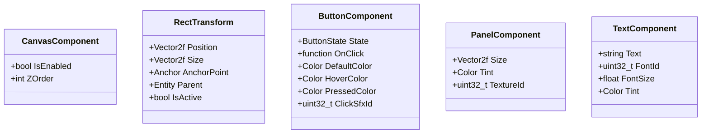
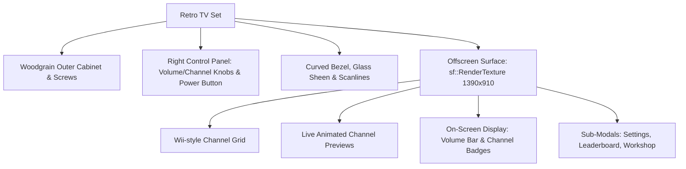
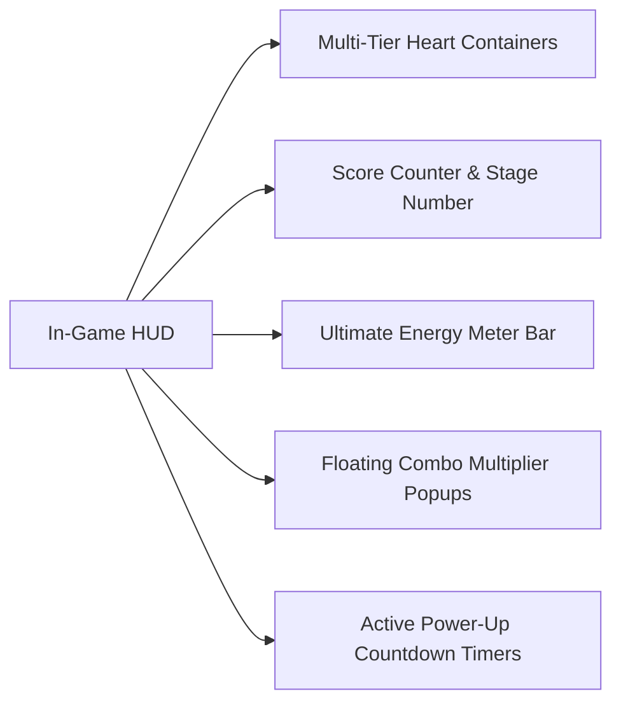

# UI Framework & Menu Systems Manual

This document details the user interface architecture, the retro CRT television simulation, the unified `SettingsUIController`, the Workshop shop, and in-game HUD systems across **REBREAKER-Reloaded**.

---

## 1. UI Component Hierarchy & System Architecture

The UI is built entirely on the engine's data-oriented ECS framework. UI elements are entities composed of lightweight components managed by `UISystem` (`Engine/include/ECS/Systems/UISystem.h`).



### 1.1 Anchoring & Screen Scaling (`Anchor`)
The `RectTransform` component supports 9 standard anchor presets:
- `TopLeft`, `TopCenter`, `TopRight`
- `MiddleLeft`, `Center`, `MiddleRight`
- `BottomLeft`, `BottomCenter`, `BottomRight`

This enables responsive layout calculation relative to logical view dimensions ($1920 \times 1080$), ensuring identical layouts across diverse window aspect ratios.

### 1.2 `UIFactory` (`Engine/include/UI/UIFactory.h`)
Provides declarative, fluent builders for common widgets:
- `UIFactory::CreateButton(registry, canvas, descriptor)`
- `UIFactory::CreatePanel(registry, canvas, descriptor)`
- `UIFactory::CreateText(registry, canvas, descriptor)`
- `UIFactory::CreateVolumeControl(registry, canvas, descriptor)` (creates LED bar arrays)
- `UIFactory::CreateDropdown(registry, canvas, descriptor)`

---

## 2. Retro CRT Television Experience (`MenuScene`)

The main menu is presented as an authentic 1980s retro CRT woodgrain television set.



### 2.1 Offscreen Surface Rendering
The television screen content is rendered to an offscreen `sf::RenderTexture` surface ($1390 \times 910\text{px}$) with $4\times$ anti-aliasing. The surface is then projected onto the curved glass of the TV cabinet with barrel curvature, glass highlights, and scanline shaders.

### 2.2 Physical TV Controls Simulation
- **Volume Knob**: Rotatable control dial ($270^\circ$ arc). Dragging, clicking, or mouse wheel scrolling smoothly modulates master volume and rotates the physical dial.
- **Channel Knob**: Stepped click rotary knob. Rotates $45^\circ$ per channel switch, accompanied by an authentic metallic rotary click SFX (`m_tvSwitchSfxId`) and a brief TV static snow burst (`m_tvStaticSnowTimer`).
- **Power Button & Dialog**: Clicking the physical power button opens a CRT prompt ("POWER OFF REBREAKER?"). Selecting YES initiates the CRT collapse animation.

### 2.3 Authentic CRT Power-Off Animation (`RenderPowerOffAnimation`)
When exiting, the game plays an authentic cathode-ray tube shutdown sequence in 3 distinct optical phases:
1. **Vertical Collapse ($0.00\text{s} - 0.40\text{s}$)**: The screen picture violently collapses vertically into an intensely bright white horizontal line.
2. **Horizontal Retraction ($0.40\text{s} - 0.65\text{s}$)**: The horizontal beam shrinks toward the center into a single intense white phosphor dot.
3. **Phosphor Dissipation ($0.65\text{s} - 0.85\text{s}$)**: The center glowing dot slowly fades into darkness with a phosphorescent glow before the window closes.

---

## 3. Unified Settings Architecture (`SettingsUIController`)

The `SettingsUIController` (`Game/include/UI/SettingsUIController.h`) encapsulates all game configuration interfaces, completely eliminating code duplication between the Main Menu and In-Game Pause screens.

```mermaid
graph TD
    SettingsUI[SettingsUIController] --> TabAudio[1. Audio Tab]
    SettingsUI --> TabRender[2. Render Tab]
    SettingsUI --> TabInputs[3. Inputs / Rebinding Tab]
    SettingsUI --> TabRules[4. Gamerules Tab]
    SettingsUI --> TabCheats[5. Cheats Tab (Dev Unlocked)]

    TabAudio --> S1[Master, SFX, Music 10-LED Volume Bars]
    TabAudio --> S2[Audio Device Selection Dropdown]

    TabRender --> R1[Fullscreen Toggle & Resolutions Dropdown]
    TabRender --> R2[CRT Shaders & Particle Toggles]

    TabInputs --> I1[Device Selector: Keyboard / Gamepad]
    TabInputs --> I2[Interactive Action Rebind Buttons]
    TabInputs --> I3[5-Second Timeout State Machine]

    TabRules --> G1[Arena Dynamic Events Toggle]
    TabCheats --> C1[God Mode, Instant Break, Extended Paddle]
```

### 3.1 Input Rebinding State Machine
When rebinding an action (`MoveLeft`, `MoveRight`, `LaunchBall`, `Pause`):
1. **Focus Lock**: `UISystem::SetNavigationEnabled(false)` disables standard button navigation to prevent accidental menu clicks.
2. **Timeout Guard**: A $5.0\text{s}$ countdown timer displays live inside the button text (e.g. `> PRESS ANY KEY (4s) <`). If no key is pressed, rebinding cancels safely without altering the existing binding.
3. **Capture & Debounce**: Keyboard key captures via `context.Input.GetLastKeyPressed()`; gamepad triggers via `context.Input.GetAnyGamepadInputTriggered(0)`. A $150\text{ms}$ debounce window ensures the button used to activate rebinding is not immediately re-captured.
4. **Persistence**: New bindings are committed to `InputRemapManager` and immediately saved to `PlayerPrefs`.

---

## 4. Workshop Shop & Permanent Progression

Located in `MenuScene` (Workshop Channel):
- **Upgrades Tab**: Allows players to invest currency earned in games into permanent stat boosts across all 16 power-up tiers.
- **Ultimates Tab**: Unlock and level up the 3 ultimate super-weapons (Plasma Orb, Disco Ball, Lucky Rain).
- **Profile Tab**: Displays lifetime statistics (total bricks destroyed, high score, playtime, currency balance) and provides a safe "Reset Save Data" button with confirmation.
- **Dynamic Inspection Window**: The right column features live animated mini-stage simulations displaying the exact power-up or ultimate currently selected.

---

## 5. In-Game HUD & Real-time Visual Feedback

Managed by `GameUIController` (`Game/include/UI/GameUIController.h`):



### 5.1 Multi-Tier Heart Containers
- **Green Heart**: Standard full health container.
- **Yellow / Gold Heart**: Bonus overhealed life.
- **Exploding Heart Animation**: When a life is lost, the heart container scales up, vibrates with rapid chromatic aberration, and bursts into small heart fragments (`m_explodingHeart`).

### 5.2 Floating Text Feedback (`TextFeedback`)
Whenever a brick streak or combo threshold is hit, a floating neon text label spawns in world space at the collision site, ascends smoothly with an ease-out curve, and fades to zero alpha over $0.8\text{s}$.

