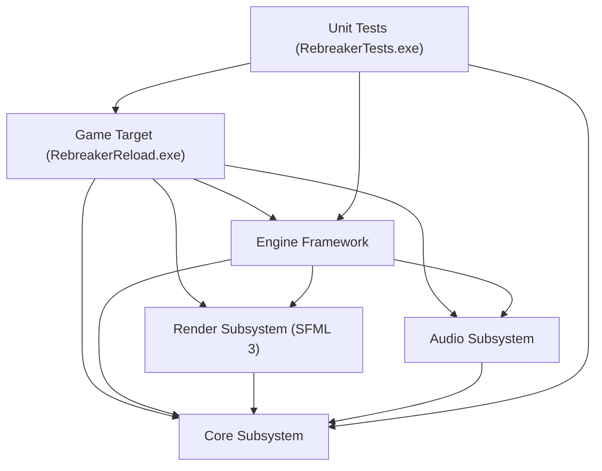

# REBREAKER-Reloaded 🕹️💥

[](https://en.cppreference.com/w/cpp/20)
[](https://www.sfml-dev.org/)
[-brightgreen.svg)]()
[]()

> **The classic arcade brick-breaker reinvented.** Built in modern C++20 with an authentic 1980s woodgrain CRT television aesthetic, a high-performance Entity-Component-System (ECS) engine, dynamic super-weapons, and deep persistent progression.

---

## 🌟 Key Features

- 📺 **Authentic Retro CRT Experience**:
  - Immersive 1980s woodgrain TV cabinet with rotatable physical dials (volume & stepped channel selector).
  - Wii-inspired channel selector grid with live animated vignettes.
  - Realistic CRT optical simulation: barrel curvature, scanlines, phosphor glow, static bursts, and an authentic 3-phase CRT power-off collapse animation.
- 🧱 **High-Impact Modernized Brick-Breaking**:
  - 7 unique brick archetypes: Normal, Multi-hit Hard, Indestructible Gold, Explosive TNT Cascades, Guaranteed Items, Speed Boosters, and Toxic Hazards.
  - Dynamic paddle deflection physics based on strike offset, angular momentum, and anti-stall protection.
  - Uncapped streak combos with neon float text feedback and arena palette shifts.
- ⚡ **16 Unique Power-Ups**:
  - Tactical enhancements: Multi-Ball, FireBall (piercing comet), Dual Laser Cannons, Sticky Paddle, Bottom Shield, Lightning Storm, Ghost Ball, and more!
- 🔮 **Devastating Ultimate Abilities**:
  - Charge your super meter through gameplay to unleash screen-clearing super-weapons: **Boule de Plasma** (radial electric shockwaves), **Ball Disco** (360° rotating laser party), and **Pluie de Power-Up** (torrential bonus cascade).
- 🛠️ **Permanent Workshop Progression**:
  - Earn bank currency across campaigns to permanently upgrade power-up durations and ultimate tier potencies in the Workshop.
  - Interactive right-column inspector with real-time animated stage simulations.
- ⚙️ **Unified Settings & Full Accessibility (`SettingsUIController`)**:
  - 5 comprehensive tabs: Audio (LED meters, device switching), Render (Fullscreen, resolutions, shaders), Inputs (Keyboard & Gamepad rebinding with live countdown), Gamerules, and Cheat Engine.
- 🏆 **Local High Scores & Records**:
  - Persistent leaderboards tracking player initials, scores, and highest stages achieved.

---

## 🏛️ Architecture & Codebase Structure

REBREAKER-Reloaded follows a strictly decoupled, data-oriented architecture:



### Directory Layout

```
REBREAKER-Reloaded/
├── Core/               # Platform utilities, InputManager, EventDispatcher, PlayerPrefs, Math
├── Render/             # SFML 3 graphics wrapper, Window, Camera2D, Renderer, Shaders
├── Audio/              # Multi-channel AudioMixer, SFX voice pooling, streaming BGM
├── Engine/             # ECS Registry, Component pools, SceneManager, UISystem, Tweens
├── Game/               # Game scenes (MenuScene, GameScene, EndlessScene), Bricks, Power-ups
├── Resources/          # Audio tracks, SFX, sprites, fonts, shaders, and level JSONs
├── SaveData/           # Runtime persistent state (prefs.json, profile.json, leaderboard.json)
├── Tests/              # 153 doctest unit and integration test suites
└── Docs/               # Exhaustive technical documentation manuals
    ├── ARCHITECTURE.md          # Multi-layer architecture & ECS design
    ├── ENGINE_SUBSYSTEMS.md     # Core, Render, Audio, and Math deep-dive
    ├── GAMEPLAY_SYSTEMS.md      # Ball physics, bricks, combo, power-ups & ultimates
    ├── UI_AND_MENUS.md          # Retro CRT TV, SettingsUIController, Workshop
    └── DATA_AND_SERIALIZATION.md# JSON level schemas & player profile formats
```

---

## 🎮 Controls

The game features full support for both **Keyboard** and **Gamepads / Controllers** with real-time rebinding.

| Action | Default Keyboard | Default Gamepad (Xbox / Generic) |
|---|---|---|
| **Move Left** | `A` or `Left Arrow` | Left Stick Left / D-Pad Left |
| **Move Right**| `D` or `Right Arrow` | Left Stick Right / D-Pad Right |
| **Launch Ball / Fire Lasers** | `Space` | Button `A` / Right Trigger |
| **Trigger Ultimate** | `Q` / `E` | Button `Y` / Right Bumper |
| **Pause Game** | `Escape` | `Start` / Menu Button |
| **CRT Channel / TV Knob** | Mouse Click & Drag | D-Pad Up / Down |

---

## 🛠️ Building & Running

### Prerequisites
- **Compiler**: Modern C++20 compliant compiler (MSVC v143+ / Visual Studio 2022/2026, Clang 16+, GCC 13+).
- **Build System**: CMake 3.25+ and Ninja (recommended).
- **Dependencies**: SFML 3.0.2 (automatically installed via vcpkg or system package manager).

### Quick Build (Windows / MSVC + Ninja)

```powershell
# 1. Clone repository
git clone https://github.com/noapa/REBREAKER-Reloaded.git
cd REBREAKER-Reloaded

# 2. Configure with CMake
cmake -B out/build/x64-Debug -G "Ninja" -DCMAKE_BUILD_TYPE=Debug

# 3. Compile game & tests
ninja -C out/build/x64-Debug RebreakerReload RebreakerTests

# 4. Run automated test suite
./out/build/x64-Debug/bin/RebreakerTests.exe

# 5. Launch game
./out/build/x64-Debug/bin/RebreakerReload.exe
```

---

## 🧪 Automated Testing

All gameplay rules, collision models, profile serialization, and UI controllers are verified with an automated `doctest` test suite:

```
===============================================================================
[doctest] test cases:  153 |  153 passed | 0 failed | 0 skipped
[doctest] assertions: 2107 | 2107 passed | 0 failed |
[doctest] Status: SUCCESS!
```

To run all unit tests:
```powershell
./out/build/x64-Debug/bin/RebreakerTests.exe
```

---

## 📚 Deep-Dive Technical Documentation

For complete technical specifications, consult the manuals in the [`Docs/`](Docs/) directory:

- [**System Architecture (`Docs/ARCHITECTURE.md`)**](Docs/ARCHITECTURE.md): Multi-target layout, ECS cache mechanics, and EventDispatcher.
- [**Engine Subsystems (`Docs/ENGINE_SUBSYSTEMS.md`)**](Docs/ENGINE_SUBSYSTEMS.md): Detailed internals of Core, Render, Audio, and Tween engines.
- [**Gameplay Systems (`Docs/GAMEPLAY_SYSTEMS.md`)**](Docs/GAMEPLAY_SYSTEMS.md): Ball reflection models, combo math, 16 power-ups, and ultimate abilities.
- [**UI & Menus (`Docs/UI_AND_MENUS.md`)**](Docs/UI_AND_MENUS.md): CRT television simulation, `SettingsUIController`, and in-game HUD.
- [**Data & Serialization (`Docs/DATA_AND_SERIALIZATION.md`)**](Docs/DATA_AND_SERIALIZATION.md): Level JSON specification and player progression schemas.

---

## 📄 License

Proprietary project. All rights reserved by the development team.